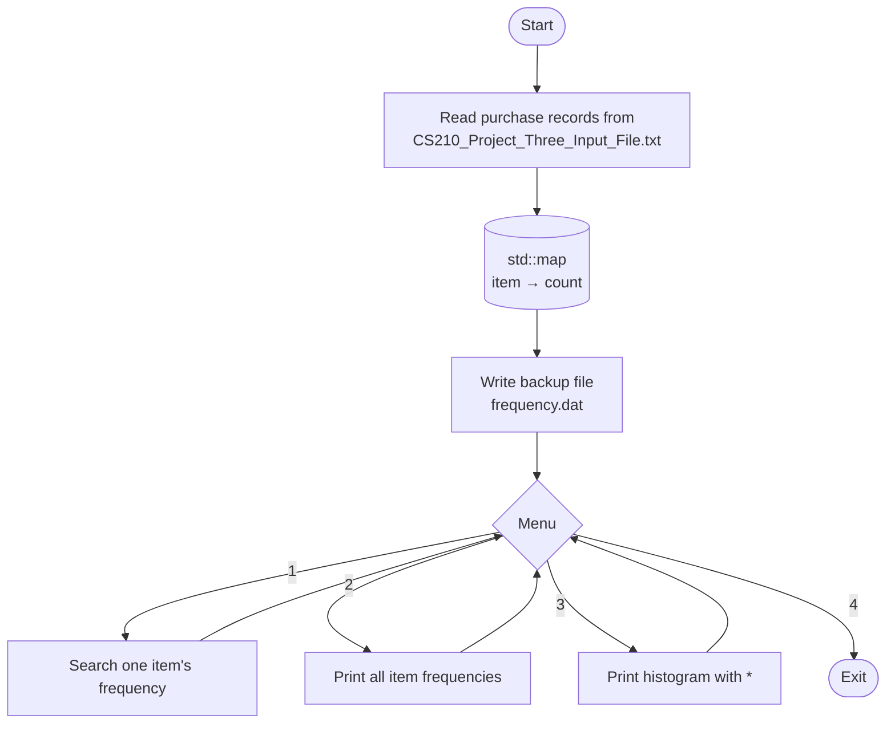

# Corner Grocer Item Tracker: C++ (CS 210)

A menu-driven C++ program for the Corner Grocer that reads a day's purchase records and counts how often each item was bought. It can search for one item, list every item's frequency, draw a text histogram, and save a backup file of the results.

Built for **CS 210: Programming Languages** at Southern New Hampshire University.

---

## How It Works



## Sample Output

```
==== Corner Grocer Item Tracking Menu ====
1. Search for an item frequency
2. Display all item frequencies
3. Display item frequencies histogram
4. Exit program
Enter your choice: 1

Enter the item you wish to search for: Spinach
Spinach appears 5 time(s).

Enter your choice: 3

Apples ****
Beets ***
Broccoli *******
Cranberries **********
```

## Project Structure

| File | Description |
|---|---|
| `main.cpp` | Menu loop and user input |
| `GroceryTracker.h` / `GroceryTracker.cpp` | `GroceryTracker` class: loading, counting, searching, printing, and backup |
| `CS210_Project_Three_Input_File.txt` | Input data: one purchased item per line |
| `frequency.dat` | Backup file of item counts produced by the program |

## Build and Run

```bash
g++ -std=c++17 -o grocery_tracker main.cpp GroceryTracker.cpp
./grocery_tracker
```

> The backup path in `main.cpp` was set for my Visual Studio setup on Windows. Change it to `"frequency.dat"` to write the backup in the current folder on any system.

## Skills Demonstrated

C++ · object-oriented design with classes · `std::map` · file input/output · menu-driven console programs

---

## Reflection

### What I Did Well
One thing I did well was organizing the program using a class and separate functions. This made the code easier to understand and maintain. I also gained experience working with maps, file input/output, and menu-driven applications.

### Areas of Improvement
If I were to improve the project, I would add stronger input validation and make the file handling more flexible so the program could be used in different environments without changing file paths.

### Challenges and Problem Solving
The most challenging part of this project was debugging issues related to file handling and data processing. I learned the importance of testing, troubleshooting, and carefully reviewing program logic when things do not work as expected.

### Transferable Skills
This project strengthened my skills in object-oriented programming, debugging, problem-solving, and file I/O. These are skills that will transfer directly to future programming projects and coursework.

### Maintainability, Readability, and Adaptability
I used meaningful variable names, comments, and a modular design to make the program easier to read and maintain. Separating the functionality into a GroceryTracker class and multiple functions also makes it easier to expand the program in the future.
